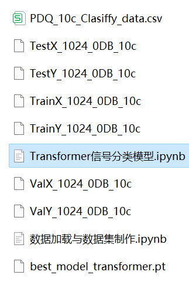

# Pytorch-Transformer Power Quality Disturbance Signal Classification: One-Dimensional Signal Classification

Includes a complete dataset of power quality disturbance signals, as well as a fully-generated dataset of ten types of disturbance signals, categorized data, and label sets. All code is available for running.
Includes preprocessing codes for the data and Transformer classification model codes.
Environment: Python 3.9.

## Images

<!-- PAYMENT_BLOCK -->

## Get this dataset

- Payment link (Stripe): [Buy now](https://buy.stripe.com/3cs8yP7sY87d0vu9AB)
- Payment QR code: 

<!-- /PAYMENT_BLOCK -->
